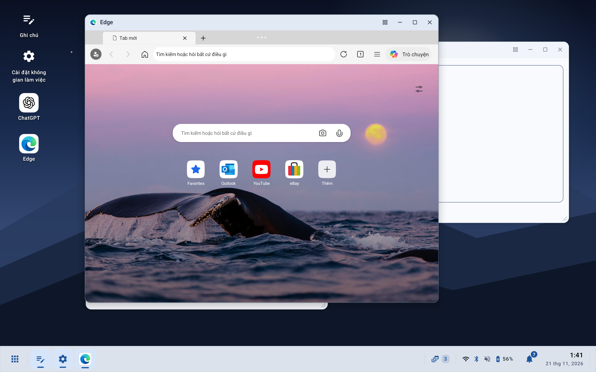
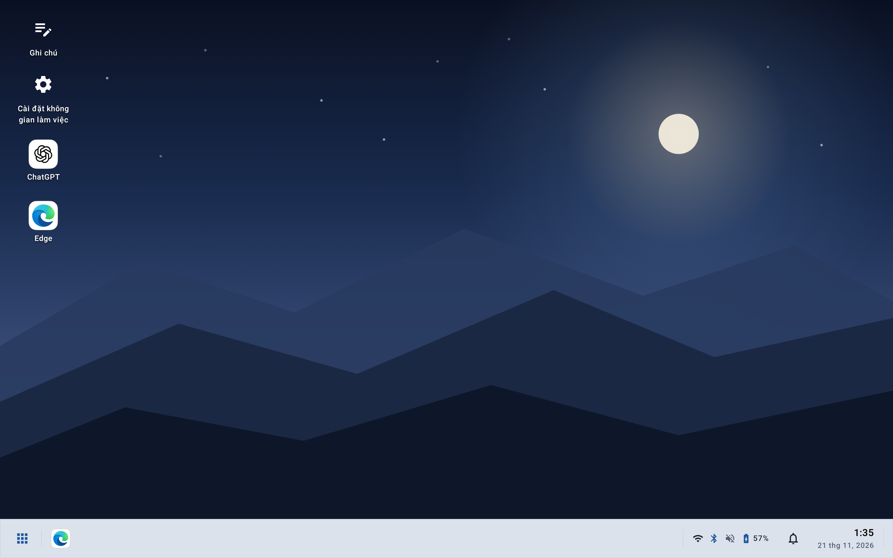
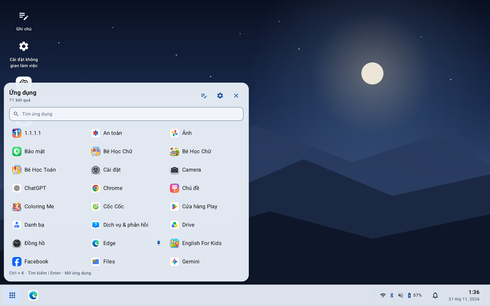

<div align="center">

# 🖥️ OpenDex

**Không gian làm việc Desktop mã nguồn mở cho Android — Biến điện thoại và máy tính bảng thành máy tính để bàn thực thụ**

[-3DDC84?logo=android&logoColor=white)](https://developer.android.com)
[](https://kotlinlang.org)
[-4285F4?logo=jetpackcompose&logoColor=white)](https://developer.android.com/compose)
[](#tính-năng-đa-nhiệm-cửa-sổ-với-shizuku-adb)
[](#đa-ngôn-ngữ-i18n)

[Tính năng & Ảnh chụp màn hình](#-tổng-quan-tính-năng--ảnh-chụp-màn-hình) •
[Mục tiêu hiển thị](#-hỗ-trợ-mọi-màn-hình) •
[Phím tắt & Điều khiển](#-phím-tắt--điều-khiển) •
[Cài đặt & Sử dụng](#-cài-đặt--hướng-dẫn-sử-dụng) •
[Kiến trúc & Công nghệ](#-công-nghệ--kiến-trúc) •
[Đóng góp](#-đóng-góp-open-source)

<br>



</div>

---

## 🌟 Giới thiệu

**OpenDex** là môi trường Desktop (Desktop Workspace & Launcher) mã nguồn mở dành cho Android, được viết hoàn toàn mới bằng **Kotlin** và **Jetpack Compose (Material 3)**.

Mục tiêu của OpenDex là mang lại trải nghiệm máy tính để bàn mượt mà, đồng nhất trên **nhiều thiết bị Android nhất có thể** — từ máy tính bảng không hỗ trợ xuất hình qua cổng USB-C (như *POCO Pad M1*), điện thoại kết nối màn hình rời qua cáp USB-C/HDMI (*Samsung DeX, Motorola Ready For...*), cho đến màn hình truyền không dây qua Wi-Fi (*Miracast, Wireless Display, Google Cast*).

- **Không cần Root:** Toàn bộ tính năng cốt lõi hoạt động ngay sau khi cài đặt mà không cần quyền đặc biệt.
- **Đa nhiệm cửa sổ thực thụ (Tùy chọn qua Shizuku / ADB):** Mở các ứng dụng Android ngay bên trong cửa sổ có thanh tiêu đề, kéo thả, thay đổi kích thước và chia đôi màn hình trực tiếp trên workspace của OpenDex.
- **Tối ưu cho cả Chuột + Bàn phím lẫn Cảm ứng:** Hỗ trợ đầy đủ rê chuột (hover), chuột phải, cuộn trang, phím tắt bàn phím và thao tác chạm/nhấn giữ.

---

## 📸 Tổng quan tính năng & Ảnh chụp màn hình

Bảng dưới đây tóm tắt nhanh các nhóm chức năng hiện có của OpenDex cùng hình ảnh minh họa tương ứng:

| Nhóm tính năng | Chi tiết chức năng | Ảnh chụp màn hình |
| :--- | :--- | :---: |
| **1. Không gian làm việc Desktop & Shortcut** | • **7 bộ hình nền dựng sẵn** (*Mountain, Sunset, Aurora, Ocean, Forest, Dusk, Solid*) hoặc chọn **ảnh tùy chỉnh từ thư viện**.<br>• **Shortcut màn hình nền:** Ghim ứng dụng yêu thích ra Desktop, hỗ trợ bật/tắt hiển thị shortcut.<br>• **Menu ngữ cảnh Desktop:** Nhấp chuột phải hoặc nhấn giữ trên màn hình nền để đổi nhanh kiểu Dock, ẩn toàn bộ cửa sổ hoặc mở cài đặt.<br>• **Giao diện Material 3:** Chế độ **Tối (Dark)**, **Sáng (Light)** hoặc **Theo hệ thống (System)**. |  |
| **2. Cửa sổ ứng dụng đa nhiệm thật (Hosted App Windows)** | • **Chạy ứng dụng Android trong cửa sổ Desktop** (khi cấp quyền qua Shizuku chế độ ADB) với thanh tiêu đề, nút **Thu nhỏ, Phóng to / Khôi phục, Đóng**.<br>• **Edge Snapping & Tiling:** Kéo cửa sổ sát mép trái/phải để chia đôi màn hình (`50/50`) hoặc kéo lên mép trên để phóng to toàn màn hình.<br>• **2 chế độ đổi kích thước:** *Khung trực tiếp (Live frame)* hoặc *Khung viền xem trước (Outline preview)* kèm thông số pixel theo thời gian thực.<br>• **Tự động chuẩn hóa DPI & Tỷ lệ cửa sổ:** Tùy chọn *Nhỏ gọn (85%)*, *Tiêu chuẩn (100%)*, *Thoải mái (120%)* giúp giao diện app trên tablet/điện thoại hiển thị cân đối như PC.<br>• **Ghi nhớ phiên làm việc:** Tự động lưu và khôi phục các cửa sổ ứng dụng đang mở khi quay lại OpenDex. |  |
| **3. Thanh Dock / Taskbar tùy biến cao** | • **2 phong cách hiển thị:** **Dock nổi (Floating)** hiện đại hoặc **Thanh tác vụ toàn chiều ngang (Full-width Panel)** kiểu PC truyền thống.<br>• **Tùy chỉnh kích thước & vị trí:** 3 cỡ (*Nhỏ gọn, Vừa, Lớn*) và căn lề (*Giữa* hoặc *Trái*).<br>• **Quản lý tác vụ trực quan:** Hiển thị ứng dụng đã ghim, ứng dụng đang mở/đang thu nhỏ, bảng **Quản lý cửa sổ đang mở** (*Thu nhỏ tất cả / Khôi phục tất cả / Đóng tất cả*) và nút **Hiện màn hình nền (Show Desktop)**. |  |
| **4. Menu Ứng dụng & Tìm kiếm tức thì** | • **Mở nhanh bằng `Ctrl + K`:** Tìm kiếm ứng dụng theo thời gian thực ngay khi gõ.<br>• **Điều hướng bàn phím 100%:** Dùng `↑`/`↓`/`Tab` để chọn, `Enter` để mở ứng dụng, `Esc` để đóng.<br>• **Menu chuột phải / Nhấn giữ đầy đủ:** *Mở trong cửa sổ*, *Mở toàn màn hình*, *Ghim vào thanh ứng dụng*, *Thêm vào màn hình nền*, *Thông tin ứng dụng*, *Gỡ cài đặt*. |  |
| **5. Khay hệ thống, Cài đặt nhanh & Lịch** | • **Bảng Cài đặt nhanh (Quick Settings):** Xem trạng thái và điều chỉnh nhanh **Wi-Fi** (hiện tên mạng SSID), **Bluetooth**, **Âm thanh** (thanh trượt âm lượng & nút tắt tiếng), **Độ sáng màn hình**, **Truyền màn hình (Cast)**, thông tin **Màn hình** và **Pin**.<br>• **Đồng hồ & Lịch tháng tương tác:** Nhấp vào đồng hồ trên Dock để mở lịch tháng, duyệt các tháng trước/sau hoặc quay nhanh về *Hôm nay*. |  |
| **6. Trung tâm thông báo (Notification Center)** | • **Thông báo chuẩn Desktop:** Tích hợp `NotificationListenerService` giúp nhận thông báo hệ thống ngay trên thanh tác vụ cùng **banner thông báo nổi** ở góc màn hình.<br>• **Tương tác trực tiếp:** Xem chi tiết, xóa từng thông báo hoặc xóa tất cả.<br>• **Mở thông báo trong cửa sổ:** Nhấp vào thông báo hoặc nút hành động để mở ngay ứng dụng đó bên trong cửa sổ Desktop của OpenDex. |  |
| **7. Công cụ tích hợp: Ghi chú & Tỷ lệ hiển thị** | • **Cửa sổ Ghi chú (Notes):** Soạn thảo và lưu tự động bản nháp cục bộ ngay trên thiết bị, hỗ trợ kéo thả, chia đôi màn hình và thu nhỏ xuống Dock.<br>• **Độ phân giải & Tỷ lệ hiển thị (Display Scale):** 5 mức thu phóng không gian làm việc (*Rộng hơn 75%, Nhỏ gọn 85%, Mặc định 100%, Lớn 115%, Rất lớn 125%*) hiển thị rõ độ phân giải logic (`dp`) và độ phân giải gốc (`px`). |  |
| **8. Đa màn hình, Launcher & Kiểm tra thiết bị** | • **Làm Màn hình chính (Home Launcher):** Tùy chọn đặt OpenDex làm trình khởi chạy mặc định khi nhấn nút Home, hoặc dùng như ứng dụng độc lập.<br>• **Chẩn đoán & Kiểm tra thiết bị:** Hiển thị thông số màn hình, DPI, trạng thái hỗ trợ *Secondary Activities* & *Freeform Windows* của Android, danh sách màn hình ngoài và nút mở thử OpenDex trên màn hình phụ. |  |

---

## 🖥️ Hỗ trợ mọi màn hình

OpenDex được thiết kế với triết lý **Display-Agnostic** (không phụ thuộc cứng vào một màn hình hay một hãng sản xuất):

1. **Màn hình tích hợp trên thiết bị (On-device Display):** Trải nghiệm Desktop trực tiếp trên màn hình máy tính bảng hoặc điện thoại (rất hữu ích khi kết hợp với bàn phím và chuột Bluetooth/USB).
2. **Màn hình ngoài có dây (Wired External Display):** Kết nối qua cổng USB-C / DisplayPort Alt-Mode, bộ chuyển HDMI hoặc hub. Khi thiết bị có sẵn môi trường desktop của hãng (*Samsung DeX, Motorola Ready For...*), OpenDex chạy mượt mà bên trong đó; khi thiết bị không có sẵn, OpenDex trực tiếp cung cấp không gian làm việc.
3. **Màn hình ngoài không dây (Wireless / Wi-Fi Cast):** Hỗ trợ Miracast / Wi-Fi Display, Chromecast / Google Cast và các chế độ desktop không dây.
   - *Lưu ý:* Chế độ phản chiếu màn hình (Screen Mirroring) sẽ hiển thị cùng workspace của màn hình chính, còn thiết bị chỉ nhận phát media (Google Cast media receiver) không phải là màn hình chạy cửa sổ Android độc lập.

> **Bố cục độc lập & An toàn khi rút/cắm:** Vị trí và kích thước các cửa sổ trên màn hình thiết bị và màn hình ngoài được lưu trữ tách biệt. Việc cắm/rút cáp hay ngắt truyền không dây sẽ không làm ứng dụng bị crash hay mất ghi chú/ứng dụng đã ghim.

---

## ⌨️ Phím tắt & Điều khiển

OpenDex hỗ trợ song song **Chuột + Bàn phím** và **Cảm ứng** trên mọi màn hình:

| Thao tác | Bàn phím & Chuột | Cảm ứng (Touch) |
| :--- | :--- | :--- |
| **Mở tìm kiếm ứng dụng** | `Ctrl + K` (khi OpenDex đang có focus) | Chạm vào nút **Ứng dụng (Apps)** trên Dock |
| **Duyệt kết quả tìm kiếm** | Phím mũi tên `↑` / `↓` hoặc `Tab` / `Shift + Tab` | Cuộn và chạm trực tiếp |
| **Mở ứng dụng đang chọn** | `Enter` hoặc Nhấp chuột trái | Chạm vào biểu tượng ứng dụng |
| **Mở menu tùy chọn ứng dụng** | Nhấp chuột phải hoặc `Shift + F10` | Nhấn giữ (Long-press) vào biểu tượng |
| **Đóng menu / bảng bật lên** | `Esc` | Chạm ra vùng trống hoặc nút Đóng |
| **Chia đôi / Phóng to cửa sổ** | Kéo thanh tiêu đề sát mép Trái / Phải / Trên, hoặc dùng nút bố cục | Kéo thanh tiêu đề sát mép Trái / Phải / Trên, hoặc chạm nút bố cục |
| **Đổi kích thước cửa sổ** | Kéo góc dưới bên phải hoặc cạnh cửa sổ | Kéo góc dưới bên phải của cửa sổ |

---

## 🚀 Cài đặt & Hướng dẫn sử dụng

### 1. Yêu cầu hệ thống & Build từ mã nguồn

- **Thiết bị Android:** Android 10 trở lên (`minSdk 29`, `targetSdk 36`).
- **Môi trường Build:** Android SDK 36 và JDK 17 (hoặc JDK 21).

Mở dự án bằng **Android Studio** hoặc chạy lệnh sau trong thư mục gốc của dự án:

```bash
./gradlew :app:assembleDebug :app:testDebugUnitTest :app:lintDebug
```

File APK sau khi build sẽ nằm tại:
`app/build/outputs/apk/debug/app-debug.apk`

Cài đặt trực tiếp lên thiết bị qua ADB (hoặc chép file APK sang máy để cài):

```bash
adb install -r app/build/outputs/apk/debug/app-debug.apk
```

### 2. Tính năng đa nhiệm cửa sổ với Shizuku (ADB — Không cần Root)

Bản dựng Debug của OpenDex hỗ trợ mở các ứng dụng Android tương thích bên trong **cửa sổ Desktop ngay trên workspace** (hoặc cửa sổ nổi Freeform của hệ thống) thông qua Shizuku mà **không cần Root máy**:

1. Cài đặt **APK Debug của OpenDex** và ứng dụng [Shizuku (phiên bản 13 trở lên)](https://github.com/RikkaApps/Shizuku/releases).
2. Khởi động Shizuku ở **chế độ ADB** (thông qua *Gỡ lỗi không dây / Wireless debugging* ngay trên máy hoặc bằng lệnh ADB qua cáp USB).
3. Mở OpenDex, vào **Cài đặt không gian làm việc → Ứng dụng cửa sổ nổi (ADB) → Cho phép qua Shizuku** và xác nhận cấp quyền.
4. Khi đã cấp quyền:
   - **Chạm / Nhấp chuột trái** vào ứng dụng để mở trực tiếp trong cửa sổ Desktop của OpenDex (có thanh tiêu đề, nút thu nhỏ, phóng to, đóng và kéo đổi kích thước).
   - **Nhấp chuột phải / Nhấn giữ** vào ứng dụng nếu muốn chọn mở toàn màn hình hoặc các tùy chọn khác.

> **Khi không dùng Shizuku hoặc dùng bản Release:** Các tính năng Desktop cốt lõi (thanh Dock, tìm kiếm, ghim ứng dụng, mở ứng dụng thông thường, cửa sổ Ghi chú, Cài đặt, Khay hệ thống, Thông báo, Lịch) vẫn hoạt động đầy đủ mà không cần bất kỳ quyền ADB nào.

### 3. Trung tâm thông báo & Tên mạng Wi-Fi (Tùy chọn)

- **Thông báo trên Taskbar:** Nhấp vào biểu tượng chuông thông báo trên Dock và chọn **Bật quyền truy cập thông báo** để cho phép OpenDex hiển thị thông báo hệ thống.
- **Hiển thị tên Wi-Fi (SSID):** Trong bảng Cài đặt nhanh, chọn **Hiện tên** và cấp quyền vị trí nếu bạn muốn Android cho phép hiển thị tên mạng Wi-Fi đang kết nối.

---

## 🌐 Đa ngôn ngữ (i18n)

OpenDex hỗ trợ sẵn 2 ngôn ngữ đồng bộ:
- 🇺🇸 **Tiếng Anh (`en`)** — Ngôn ngữ mặc định / dự phòng.
- 🇻🇳 **Tiếng Việt (`vi`)** — Bản dịch tiếng Việt đầy đủ, tự nhiên.

Trên Android 13+, bạn có thể chọn riêng ngôn ngữ Tiếng Anh hoặc Tiếng Việt cho OpenDex trong phần **Cài đặt hệ thống → Ngôn ngữ ứng dụng (Per-app language preferences)**.

---

## 🛠️ Công nghệ & Kiến trúc

- **Ngôn ngữ:** 100% [Kotlin](https://kotlinlang.org/) (JVM Target 17).
- **Giao diện (UI):** 100% [Jetpack Compose](https://developer.android.com/compose) với hệ thống thiết kế **Material 3** (`androidx.compose.material3`).
- **Quản lý trạng thái & Lưu trữ:** Kiến trúc Unidirectional Data Flow (UDF) kết hợp `ViewModel`, Kotlin `StateFlow`/`Coroutines` và ` Jetpack DataStore Preferences` để lưu trữ bền vững bố cục cửa sổ, ứng dụng đã ghim, hình nền và bản nháp ghi chú.
- **Kiểm thử:**
  - Chạy Unit Tests & Lint: `./gradlew :app:testDebugUnitTest :app:lintDebug`
  - Chạy Compose UI Tests trên thiết bị/máy ảo: `./gradlew :app:connectedDebugAndroidTest`
  - Danh sách kiểm thử thực tế trên thiết bị: Xem chi tiết tại [`docs/device-compatibility.md`](docs/device-compatibility.md).

---

## 🤝 Đóng góp (Open Source)

Mọi đóng góp nhằm mở rộng khả năng tương thích thiết bị và cải thiện trải nghiệm Desktop trên Android đều được hoan nghênh!

1. **Báo lỗi & Kiểm thử thiết bị:** Nếu bạn thử nghiệm OpenDex trên điện thoại, máy tính bảng, màn hình USB-C/HDMI hoặc màn hình Cast mới, hãy cập nhật kết quả theo mẫu trong [`docs/device-compatibility.md`](docs/device-compatibility.md) và mở Issue / Pull Request.
2. **Quy tắc đóng góp mã nguồn:**
   - Viết toàn bộ UI mới bằng `@Composable` (Material 3), không sử dụng XML layout cũ.
   - Thiết kế **Display-Agnostic**: không giả định thiết bị chỉ có một màn hình cố định hay hardcode `Display.DEFAULT_DISPLAY`.
   - Mọi chuỗi hiển thị cho người dùng cần khai báo đồng thời trong cả `app/src/main/res/values/strings.xml` (Tiếng Anh) và `app/src/main/res/values-vi/strings.xml` (Tiếng Việt).
   - Xem thêm hướng dẫn chi tiết cho nhà phát triển tại [`AGENTS.md`](AGENTS.md).

---

## 🙏 Ghi nhận

- Bố cục thanh tác vụ lấy cảm hứng từ trải nghiệm desktop trên tablet và [Smart Dock](https://github.com/axel358/smartdock); OpenDex được thiết kế và viết mới hoàn toàn bằng Kotlin & Jetpack Compose, không sử dụng lại mã nguồn hay tài nguyên từ Smart Dock.
- Tích hợp quyền ADB tùy chọn thông qua [Shizuku](https://github.com/RikkaApps/Shizuku).
