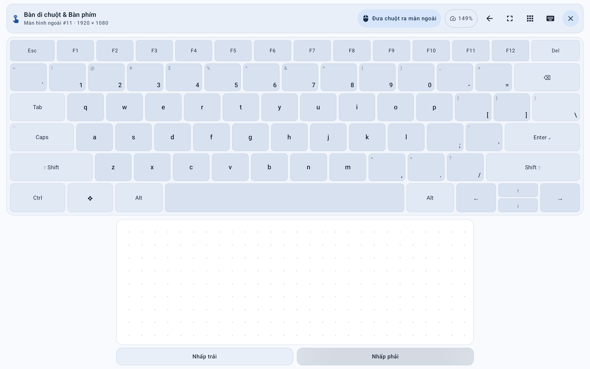
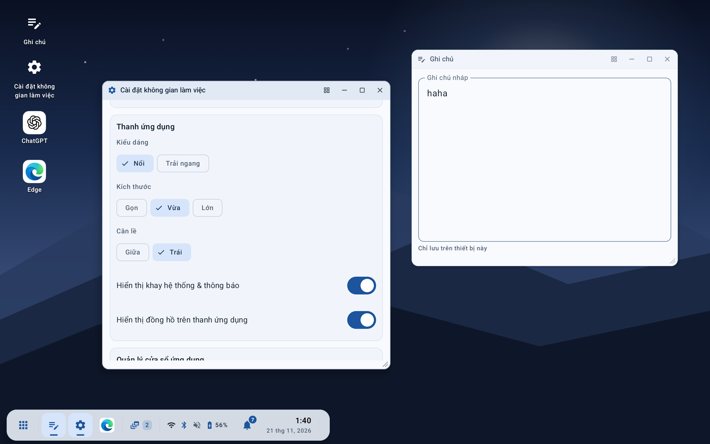
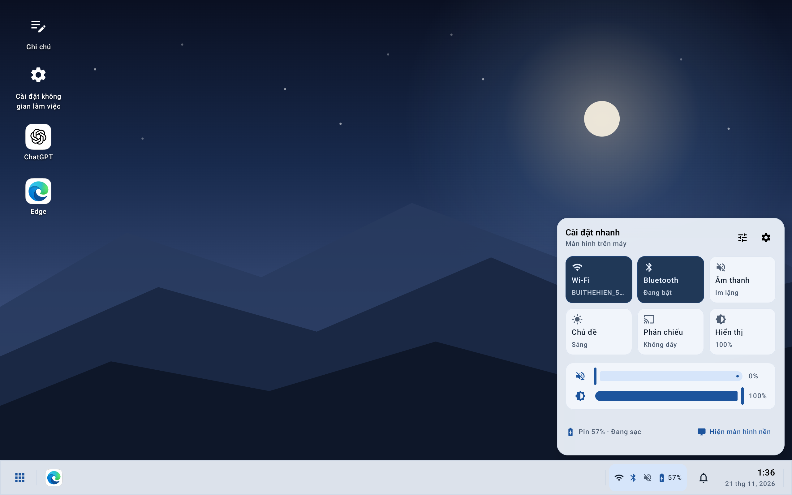
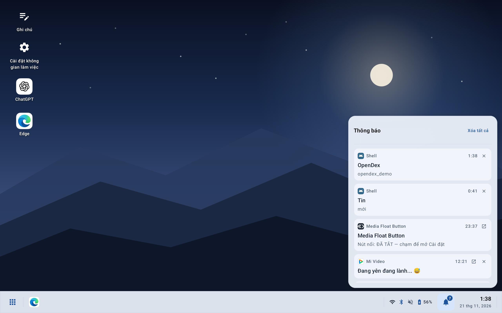
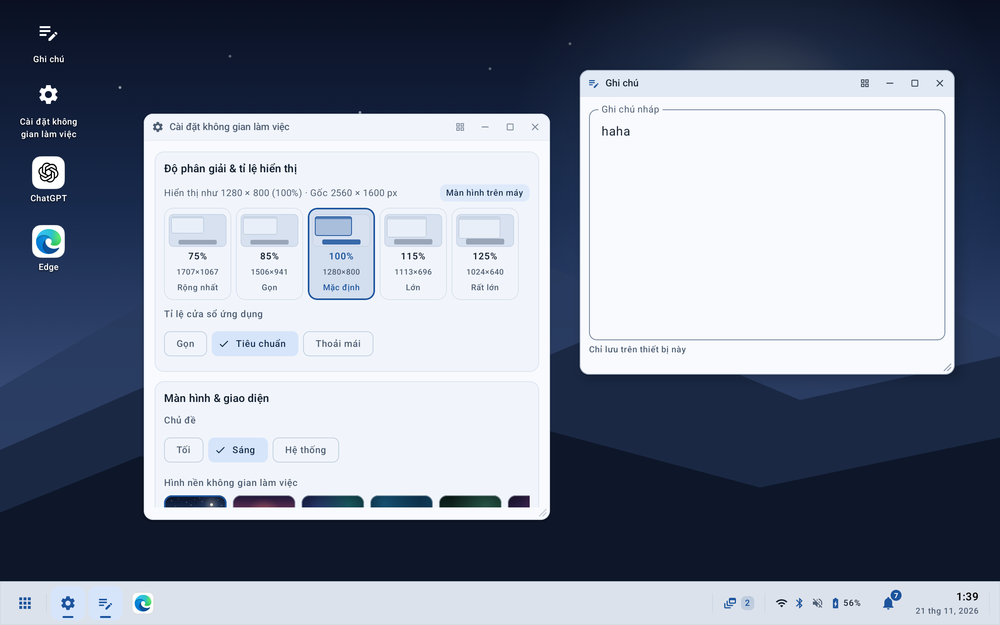
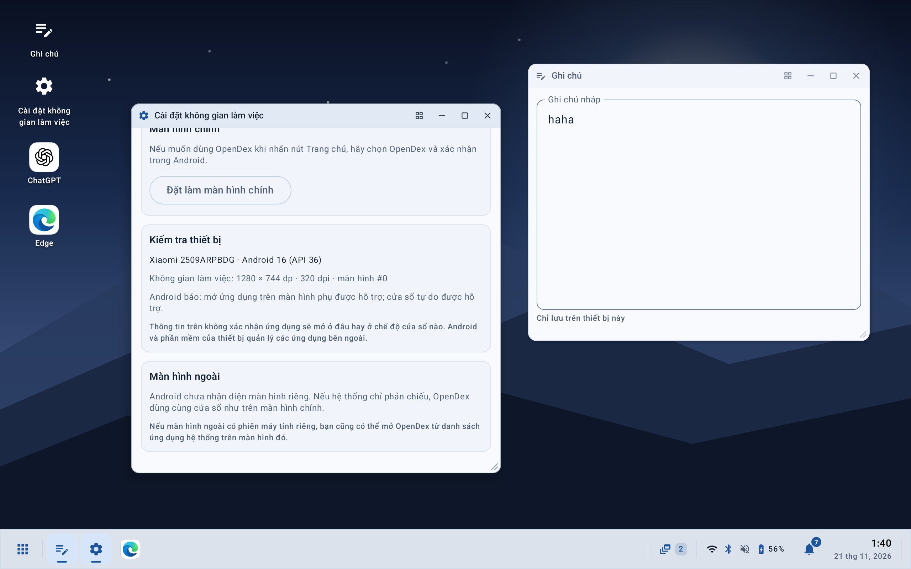

<div align="center">

# 🖥️ OpenDex

**Không gian làm việc Desktop mã nguồn mở cho Android — Biến điện thoại và máy tính bảng thành máy tính để bàn thực thụ**

[-3DDC84?logo=android&logoColor=white)](https://developer.android.com)
[](https://kotlinlang.org)
[-4285F4?logo=jetpackcompose&logoColor=white)](https://developer.android.com/compose)
[](#2-tùy-chọn-đa-nhiệm-cửa-sổ-thực-thụ-không-cần-root)
[](#đa-ngôn-ngữ-i18n)

[Tính năng & Ảnh chụp màn hình](#-tổng-quan-tính-năng--ảnh-chụp-màn-hình) •
[Mục tiêu hiển thị](#-hỗ-trợ-mọi-màn-hình) •
[Phím tắt & Điều khiển](#-phím-tắt--điều-khiển) •
[Cài đặt & Sử dụng](#-cài-đặt--hướng-dẫn-sử-dụng) •
[Dành cho nhà phát triển](#-dành-cho-nhà-phát-triển-build-từ-mã-nguồn) •
[Kiến trúc & Công nghệ](#-công-nghệ--kiến-trúc) •
[Đóng góp](#-đóng-góp-open-source)

<br>


</div>

---

## 🌟 Giới thiệu

**OpenDex** là môi trường Desktop (Desktop Workspace & Launcher) mã nguồn mở dành cho Android, được viết hoàn toàn mới bằng **Kotlin** và **Jetpack Compose (Material 3)**.

Mục tiêu của OpenDex là mang lại trải nghiệm máy tính để bàn mượt mà, đồng nhất trên **nhiều thiết bị Android nhất có thể** — từ máy tính bảng không hỗ trợ xuất hình qua cổng USB-C (như *POCO Pad M1*), điện thoại kết nối màn hình rời qua cáp USB-C/HDMI (*Samsung DeX, Motorola Ready For...*), cho đến màn hình truyền không dây qua Wi-Fi (*Miracast, Wireless Display, Google Cast*).

- **Không cần Root:** Toàn bộ tính năng cốt lõi hoạt động ngay sau khi cài đặt mà không cần quyền đặc biệt.
- **Đa nhiệm cửa sổ thực thụ (Tùy chọn qua Shizuku / ADB):** Mở các ứng dụng Android (kể cả các trang Cài đặt hệ thống như Wi-Fi, Bluetooth, Thông tin ứng dụng...) ngay bên trong cửa sổ có thanh tiêu đề, kéo thả, thay đổi kích thước, chia đôi màn hình hoặc phóng toàn màn hình thật (`F11`) trực tiếp trên workspace của OpenDex.
- **Biến thiết bị thành Bàn phím Laptop & Touchpad khi Cast/Xuất màn hình ngoài:** Khi truyền không dây (Miracast / Wi-Fi Cast) hoặc cắm cáp ra màn hình rời, OpenDex hỗ trợ cơ chế khởi chạy màn hình ngoài 3 tầng thông minh (`ExternalDisplayActivity` → `ADB Shell` → `Presentation Fallback`), biến màn hình trên máy thành bàn di chuột đa điểm và bàn phím QWERTY kiểu Laptop kèm chế độ **Làm tối màn hình máy (Blackout Mode)** tiết kiệm pin.
- **Tối ưu cho cả Chuột + Bàn phím lẫn Cảm ứng:** Hỗ trợ đầy đủ rê chuột (hover), chuột phải, cuộn trang, phím tắt quản lý cửa sổ và thao tác chạm/nhấn giữ.

---

## 📸 Tổng quan tính năng & Ảnh chụp màn hình

Bảng dưới đây tóm tắt nhanh các nhóm chức năng hiện có của OpenDex cùng hình ảnh minh họa tương ứng:

| Nhóm tính năng | Chi tiết chức năng | Ảnh chụp màn hình |
| :--- | :--- | :---: |
| **1. Không gian làm việc Desktop & Shortcut** | • **7 bộ hình nền dựng sẵn** (*Mountain, Sunset, Aurora, Ocean, Forest, Dusk, Solid*) hoặc chọn **ảnh tùy chỉnh từ thư viện**.<br>• **Shortcut màn hình nền:** Ghim ứng dụng yêu thích ra Desktop, hỗ trợ bật/tắt hiển thị shortcut.<br>• **Menu ngữ cảnh Desktop:** Nhấp chuột phải hoặc nhấn giữ trên màn hình nền để chọn nhanh ảnh nền từ thư viện, mở Cài đặt, Ghi chú, ẩn toàn bộ cửa sổ (*Hiện màn hình nền*) hoặc đóng tất cả cửa sổ.<br>• **Giao diện Material 3:** Chế độ **Tối (Dark)**, **Sáng (Light)** hoặc **Theo hệ thống (System)**. |  |
| **2. Cửa sổ ứng dụng đa nhiệm thật (Hosted App Windows)** | • **Chạy ứng dụng Android trong cửa sổ Desktop** (khi cấp quyền qua Shizuku chế độ ADB) với thanh tiêu đề, nút **Bố cục cửa sổ, Thu nhỏ, Phóng to / Khôi phục** (hoặc nhấp đúp thanh tiêu đề), **Toàn màn hình thật (`F11`), Đóng** (tự động dừng âm thanh khi đóng ứng dụng).<br>• **Thanh nổi thông minh khi Toàn màn hình thật:** Tự động ẩn thanh tiêu đề & Dock; rê chuột hoặc chạm vào mép trên màn hình để hiện thanh thoát toàn màn hình.<br>• **Edge Snapping & Phím tắt chia màn hình:** Kéo cửa sổ sát mép trái/phải để chia đôi (`50/50`), kéo lên mép trên để phóng to, hoặc dùng tổ hợp `Win/Meta + ←/→/↑/↓` (`Ctrl + Alt + ←/→/↑/↓`).<br>• **2 chế độ đổi kích thước:** *Khung trực tiếp (Live frame)* hoặc *Khung viền xem trước (Outline preview)* kèm thông số pixel theo thời gian thực.<br>• **Tự động chuẩn hóa DPI & Tỷ lệ cửa sổ:** Tùy chọn *Gọn (85%)*, *Tiêu chuẩn (100%)*, *Thoải mái (120%)* giúp giao diện app trên tablet/điện thoại hiển thị cân đối như PC.<br>• **Ghi nhớ phiên làm việc:** Tự động lưu và khôi phục các cửa sổ ứng dụng đang mở (tách biệt giữa màn hình trên máy và màn hình ngoài). |  |
| **3. Bàn di chuột (Touchpad) & Bàn phím Laptop ảo cho Màn hình ngoài / Cast** | • **Biến máy thành bàn điều khiển Laptop khi Cast/Xuất màn hình ngoài:** Khi mở chế độ Desktop trên TV hoặc màn hình rời (Wi-Fi Cast / USB-C / HDMI), màn hình thiết bị tự động chuyển sang giao diện **Bàn di chuột & Bàn phím ảo** (hoặc mở nhanh từ nút trên thanh Dock).<br>• **Bàn phím QWERTY kiểu Laptop (Laptop Deck Keyboard):** Đầy đủ hàng phím `Esc`, `F1`–`F12`, `Del`, phím số, `Tab`, `Caps Lock`, các phím bổ trợ (`Shift`, `Ctrl`, `Alt`, `Meta`), cụm phím mũi tên (`←`, `↑`, `↓`, `→`), nhấn giữ để lặp phím, tự động chặn bàn phím ảo hệ thống (IME) bị trùng lặp và cho phép chuyển đổi qua lại với bàn phím hệ thống.<br>• **Chế độ Làm tối màn hình máy (Blackout Mode):** Tắt tối màn hình máy tính bảng/điện thoại để tiết kiệm pin trong khi vẫn giữ màn hình ngoài luôn sáng (chạm đúp để bật lại điều khiển).<br>• **Touchpad đa điểm & Nút chuột Trái/Phải:** Hỗ trợ 1 ngón di chuyển & chạm chọn, chạm đúp giữ để kéo cửa sổ, 2 ngón cuộn trang & nhấp phải, kèm hai phím ảo **Nhấp trái / Nhấp phải**.<br>• **Tự động bắt chuột vật lý & Chỉnh DPI (`40%`–`300%`):** Tự động chuyển tiếp chuột USB/Bluetooth sang màn hình ngoài (nhấn `Ctrl + Alt` để trả chuột về), kèm thanh trượt và 4 mức chọn nhanh **Tốc độ chuột / DPI** (`0.6×`, `1.0×`, `1.5×`, `2.2×`) được lưu bền vững. |  |
| **4. Thanh Dock / Taskbar tùy biến cao** | • **2 phong cách hiển thị:** **Dock nổi (Floating)** hiện đại hoặc **Thanh tác vụ trải ngang (Full-width Panel)** kiểu PC truyền thống.<br>• **Thanh trượt chiều cao Dock theo từng màn hình (`32 dp`–`68 dp`):** Điều chỉnh mượt mà kích thước Dock với thông số lưu độc lập cho màn hình trên máy (mặc định `52 dp`) và màn hình ngoài (mặc định `40 dp`), cùng tùy chọn căn lề (*Giữa* hoặc *Trái*) và bật/tắt Khay hệ thống hoặc Đồng hồ.<br>• **Quản lý tác vụ trực quan:** Hiển thị ứng dụng đã ghim, ứng dụng đang mở/đang thu nhỏ, nút mở nhanh **Bàn di chuột & phím** (khi có màn hình ngoài), bảng **Quản lý cửa sổ đang mở** (*Thu nhỏ hết / Đóng tất cả*) và thanh **Hiện màn hình nền (Show Desktop)** ở mép phải Dock. |  |
| **5. Menu Ứng dụng & Tìm kiếm tức thì** | • **Mở nhanh bằng `Ctrl + K`:** Tìm kiếm ứng dụng theo thời gian thực ngay khi gõ.<br>• **Điều hướng bàn phím 100%:** Dùng `↑`/`↓`/`Tab` để chọn, `Enter` để mở ứng dụng, `Esc` để đóng.<br>• **Menu chuột phải / Nhấn giữ đầy đủ:** *Mở trong cửa sổ*, *Ghim vào thanh ứng dụng*, *Thêm ra màn hình nền*, *Thông tin ứng dụng* (mở trực tiếp trong cửa sổ Desktop), *Gỡ cài đặt*. |  |
| **6. Khay hệ thống, Cài đặt nhanh & Lịch** | • **Bảng Cài đặt nhanh (Quick Settings):** Xem trạng thái và điều chỉnh nhanh **Wi-Fi** (hiện tên mạng SSID), **Bluetooth**, **Âm thanh** (thanh trượt âm lượng & nút tắt tiếng), **Chủ đề Sáng/Tối**, **Độ sáng màn hình**, **Phản chiếu không dây (Cast)**, **Hiển thị** và **Pin** (các mục cài đặt Android tự động mở trong cửa sổ Desktop khi bật Shizuku).<br>• **Đồng hồ & Lịch tháng tương tác:** Nhấp vào đồng hồ trên Dock để mở lịch tháng, duyệt các tháng trước/sau hoặc quay nhanh về *Hôm nay*. |  |
| **7. Trung tâm thông báo (Notification Center)** | • **Thông báo chuẩn Desktop:** Tích hợp `NotificationListenerService` giúp nhận thông báo hệ thống ngay trên thanh tác vụ cùng **banner thông báo nổi** ở góc trên bên phải màn hình.<br>• **Tương tác trực tiếp:** Xem chi tiết, bỏ qua từng thông báo hoặc xóa tất cả.<br>• **Mở thông báo trong cửa sổ:** Nhấp vào thông báo hoặc nút mở cửa sổ để khởi chạy ngay ứng dụng đó bên trong cửa sổ Desktop của OpenDex. |  |
| **8. Công cụ tích hợp: Ghi chú, Tỷ lệ hiển thị & Overscan** | • **Cửa sổ Ghi chú (Notes):** Soạn thảo và lưu tự động bản nháp cục bộ ngay trên thiết bị, hỗ trợ kéo thả, chia đôi màn hình và thu nhỏ xuống Dock.<br>• **Độ phân giải & Tỷ lệ hiển thị độc lập (Display Scale):** 5 mức thu phóng (*Rộng nhất 75%, Gọn 85%, Mặc định 100%, Lớn 115%, Rất lớn 125%*) được lưu riêng cho màn hình máy và màn hình ngoài, hiển thị rõ độ phân giải logic (`dp`) và độ phân giải gốc (`px`).<br>• **Viền an toàn màn hình ngoài (Overscan `0%`–`12%`):** Thanh trượt thu gọn 4 cạnh kèm khung viền xem trước trực tiếp giúp khắc phục hiện tượng TV hoặc cổng HDMI cắt mất thanh tác vụ hay viền cửa sổ. |  |
| **9. Đa màn hình, Launcher & Kiểm tra thiết bị** | • **Khởi chạy màn hình ngoài 3 tầng & Ngắt kết nối chủ động:** Tự động chọn phương thức tối ưu (`ExternalDisplayActivity` độc lập → `ADB Shell` → `Presentation Fallback`) để mở Desktop lên màn hình phụ ngay cả khi hệ thống/OEM hạn chế, kèm nút **Ngắt kết nối** phiên màn hình ngoài bất cứ lúc nào.<br>• **Làm Màn hình chính (Home Launcher):** Tùy chọn đặt OpenDex làm trình khởi chạy mặc định khi nhấn nút Home, hoặc dùng như ứng dụng độc lập.<br>• **Chẩn đoán & Kiểm tra thiết bị:** Hiển thị thông số màn hình, DPI, trạng thái hỗ trợ *Secondary Activities* & *Freeform Windows* của Android và danh sách màn hình ngoài đang hoạt động. |  |

---

## 🖥️ Hỗ trợ mọi màn hình

OpenDex được thiết kế với triết lý **Display-Agnostic** (không phụ thuộc cứng vào một màn hình hay một hãng sản xuất):

1. **Màn hình tích hợp trên thiết bị (On-device Display):** Trải nghiệm Desktop trực tiếp trên màn hình máy tính bảng hoặc điện thoại (rất hữu ích khi kết hợp với bàn phím và chuột Bluetooth/USB).
2. **Màn hình ngoài có dây (Wired External Display):** Kết nối qua cổng USB-C / DisplayPort Alt-Mode, bộ chuyển HDMI hoặc hub. Khi thiết bị có sẵn môi trường desktop của hãng (*Samsung DeX, Motorola Ready For...*), OpenDex chạy mượt mà bên trong đó; khi thiết bị không có sẵn, OpenDex trực tiếp cung cấp không gian làm việc.
3. **Màn hình ngoài không dây (Wireless / Wi-Fi Cast):** Hỗ trợ Miracast / Wi-Fi Display, Smart TV và các chế độ desktop không dây — sử dụng cơ chế khởi chạy 3 tầng (`ExternalDisplayActivity` độc lập → `ADB Shell` → `ExternalDesktopPresentation`) giúp mở phiên Desktop của OpenDex trực tiếp trên TV/màn hình không dây ngay cả trên các thiết bị chặn mở Activity màn hình phụ, trong khi **màn hình máy tính bảng/điện thoại đóng vai trò làm Bàn di chuột (Touchpad) & Bàn phím Laptop ảo**.
   - *Lưu ý:* Thiết bị chỉ nhận phát luồng media (Google Cast media receiver) không phải là màn hình hệ thống của Android nên không chạy cửa sổ độc lập.

> **Bố cục độc lập, Viền an toàn (Overscan) & An toàn khi rút/cắm:** Vị trí cửa sổ, tỷ lệ hiển thị (*Display Scale*), chiều cao thanh Dock (`32 dp`–`68 dp`) và viền an toàn màn hình ngoài (*Overscan* `0%`–`12%`) được lưu trữ tách biệt giữa màn hình máy và màn hình ngoài. Việc cắm/rút cáp hay ngắt truyền không dây sẽ không làm ứng dụng bị crash hay mất ghi chú/ứng dụng đã ghim.

---

## ⌨️ Phím tắt & Điều khiển

OpenDex hỗ trợ song song **Chuột + Bàn phím**, **Cảm ứng** và **Touchpad / Bàn phím ảo cho màn hình ngoài**:

| Thao tác | Bàn phím & Chuột | Cảm ứng / Chế độ Touchpad màn hình ngoài |
| :--- | :--- | :--- |
| **Mở tìm kiếm ứng dụng** | `Ctrl + K` (khi OpenDex đang có focus) | Chạm vào nút **Ứng dụng (Apps)** trên Dock hoặc thanh công cụ Touchpad |
| **Duyệt kết quả tìm kiếm** | Phím mũi tên `↑` / `↓` hoặc `Tab` / `Shift + Tab` | Cuộn và chạm trực tiếp |
| **Mở ứng dụng đang chọn** | `Enter` hoặc Nhấp chuột trái | Chạm vào biểu tượng ứng dụng |
| **Mở menu tùy chọn ứng dụng** | Nhấp chuột phải hoặc `Shift + F10` | Nhấn giữ (Long-press) hoặc chạm 2 ngón / nút **Nhấp phải** trên Touchpad |
| **Đóng menu / bảng bật lên** | `Esc` | Chạm ra vùng trống hoặc nút Đóng |
| **Toàn màn hình thật (True Fullscreen)** | `F11` hoặc nút Toàn màn hình trên thanh tiêu đề (đưa chuột lên mép trên để thoát) | Chạm nút Toàn màn hình trên thanh tiêu đề hoặc trên thanh công cụ Touchpad |
| **Chia đôi / Phóng to / Thu nhỏ cửa sổ** | `Win/Meta + ← / → / ↑ / ↓` (hoặc `Ctrl + Alt + ← / → / ↑ / ↓`), nhấp đúp thanh tiêu đề, hoặc kéo sát mép Trái / Phải / Trên | Chạm đúp & giữ trên Touchpad để kéo cửa sổ sát mép Trái / Phải / Trên, hoặc dùng nút Bố cục |
| **Đổi kích thước cửa sổ** | Kéo góc dưới bên phải của cửa sổ | Kéo góc dưới bên phải của cửa sổ |
| **Đưa chuột vật lý ra màn ngoài** | Tự động bắt chuột khi vào Touchpad hoặc nhấp vùng bàn di / nút **Đưa chuột ra màn ngoài** (`Ctrl + Alt` để thả chuột) | Chạm nút **Chuột ở màn ngoài** trên thanh công cụ để chuyển lại |
| **Làm tối màn hình máy (Blackout Mode)** | Nhấp nút biểu tượng Mặt trăng trên thanh Touchpad | Chạm nút Mặt trăng để làm tối màn hình máy (giữ màn ngoài sáng); **chạm đúp** để bật lại |

---

## 🚀 Cài đặt & Hướng dẫn sử dụng

Phần này dành cho **người dùng cuối** tải trực tiếp file APK phát hành về sử dụng trên điện thoại hoặc máy tính bảng Android (Android 10 trở lên).

### 1. Chọn bản APK & Cài đặt

Tải tệp APK phù hợp từ mục **Releases** trên GitHub về thiết bị Android (Android 10 trở lên):

- **`OpenDex-vX.Y.Z-standard.apk` (Bản tiêu chuẩn — Khuyên dùng cho máy chưa Root):**
  - Toàn bộ không gian làm việc Desktop (**thanh Dock, Menu ứng dụng, tìm kiếm `Ctrl + K`, Ghim ứng dụng, Ghi chú, Khay hệ thống, Lịch, xuất màn hình ngoài / Cast kèm Touchpad & Bàn phím ảo**) hoạt động đầy đủ ngay sau khi cài đặt mà **không cần Root hay ADB**.
  - Hỗ trợ tùy chọn đa nhiệm cửa sổ qua **lệnh ADB trực tiếp** hoặc **Shizuku** (xem mục 2 bên dưới).
- **`OpenDex-vX.Y.Z-root.apk` (Bản Root — Dành cho máy đã Root bằng Magisk / KernelSU / APatch):**
  - **Không cần ADB, không cần máy tính, không cần cài Shizuku.**
  - Chỉ cần mở **OpenDex Root** và nhấn **Cho phép (Grant)** quyền Superuser một lần duy nhất — đa nhiệm cửa sổ thực thụ tự động sẵn sàng ngay cả sau khi khởi động lại (reboot) thiết bị.
  - Có `applicationId` riêng (`dev.opendex.root`) nên có thể cài song song với bản tiêu chuẩn nếu cần.

> Khi cài tệp `.apk`, nếu Android yêu cầu, hãy bật **Cho phép cài đặt ứng dụng từ nguồn này / Install unknown apps**.

### 2. Tùy chọn: Đa nhiệm cửa sổ thực thụ trên bản Standard (Không cần Root)

Nếu bạn dùng bản **Standard** (máy chưa Root) và muốn mở trực tiếp các ứng dụng Android **ngay bên trong cửa sổ Desktop của OpenDex** (có thanh tiêu đề, kéo thả, chia đôi màn hình, thay đổi kích thước và phóng toàn màn hình `F11`), bạn có thể chọn **1 trong 2 cách** dưới đây:

#### Cách A: Chạy lệnh ADB trực tiếp từ máy tính (Không cần cài Shizuku)

Phù hợp nếu bạn có máy tính cài sẵn [Android Platform Tools (`adb`)](https://developer.android.com/tools/releases/platform-tools) và không muốn cài thêm app Shizuku:

1. Trên điện thoại/máy tính bảng: bật **Tùy chọn nhà phát triển (Developer options)** → bật **Gỡ lỗi USB (USB debugging)** rồi cắm cáp vào máy tính (chọn *Cho phép* nếu máy hiện hộp thoại xác nhận RSA).
2. Mở Terminal / Command Prompt trên máy tính và chạy đúng **1 lệnh** sau:
   - **macOS / Linux:**
     ```bash
     adb shell 'nohup sh -c "CLASSPATH=$(pm path dev.opendex | head -n 1 | cut -d: -f2) app_process /system/bin dev.opendex.platform.OpenDexShellServer" </dev/null >/dev/null 2>&1 &'
     ```
   - **Windows (Command Prompt / PowerShell):**
     ```powershell
     adb shell "nohup sh -c 'CLASSPATH=$(pm path dev.opendex | head -n 1 | cut -d: -f2) app_process /system/bin dev.opendex.platform.OpenDexShellServer' </dev/null >/dev/null 2>&1 &"
     ```
3. Rút cáp USB nếu muốn và mở **OpenDex** — đa nhiệm cửa sổ sẽ tự động sẵn sàng ngay lập tức (không cần bước cấp quyền bổ sung).
   - *Tắt tiến trình nền thủ công khi không dùng nữa:* `adb shell pkill -f OpenDexShellServer`

#### Cách B: Dùng Shizuku (Không cần máy tính trên Android 11+)

Phù hợp nếu bạn muốn bật trực tiếp ngay trên điện thoại/máy tính bảng mà không cần máy tính:

1. Tải và cài đặt ứng dụng [Shizuku (phiên bản 13 trở lên)](https://github.com/RikkaApps/Shizuku/releases).
2. Bật **Tùy chọn nhà phát triển (Developer options)** và kích hoạt **Gỡ lỗi không dây (Wireless debugging)** *(cần kết nối Wi-Fi)*.
3. Mở **Shizuku**, chọn **Ghép nối (Pairing)** theo hướng dẫn trên màn hình để khởi động Shizuku ở **chế độ ADB**.
   - *(Hoặc nếu đang cắm cáp vào máy tính, có thể khởi động Shizuku nhanh bằng lệnh: `adb shell sh /sdcard/Android/data/moe.shizuku.privileged.api/start.sh`)*
4. Mở **OpenDex**, vào **Cài đặt không gian làm việc → Ứng dụng cửa sổ nổi (ADB) → Cho phép qua Shizuku** và xác nhận cấp quyền.

#### Cách dùng sau khi đã kích hoạt (áp dụng cho cả Cách A và Cách B)

- **Chạm / Nhấp chuột trái** vào ứng dụng để mở trực tiếp trong cửa sổ Desktop của OpenDex.
- **Nhấp chuột phải / Nhấn giữ** vào ứng dụng nếu muốn chọn mở toàn màn hình, ghim ra màn hình nền, xem thông tin ứng dụng...

> **Lưu ý:** Cả 2 cách đều chỉ chạy trong phiên hiện tại — sau mỗi lần **khởi động lại (reboot)** thiết bị, bạn cần chạy lại lệnh ADB (Cách A) hoặc mở Shizuku nhấn **Khởi động** (Cách B). Nếu không bật, OpenDex vẫn hoạt động đầy đủ ở chế độ Desktop cơ bản.

### 3. Quyền tùy chọn khác

- **Trung tâm thông báo trên Taskbar:** Nhấp vào biểu tượng chuông thông báo trên Dock và chọn **Bật quyền truy cập thông báo** để hiển thị thông báo hệ thống ngay trên Desktop.
- **Hiển thị tên mạng Wi-Fi (SSID):** Trong bảng Cài đặt nhanh, chọn **Hiện tên** và cấp quyền vị trí để Android cho phép hiển thị tên mạng Wi-Fi đang kết nối.
- **Đặt làm Màn hình chính (Home Launcher):** Vào **Cài đặt không gian làm việc** và chọn đặt OpenDex làm trình khởi chạy mặc định nếu bạn muốn quay về OpenDex mỗi khi nhấn nút Home.

---

## 👨‍💻 Dành cho nhà phát triển (Build từ mã nguồn)

Phần này dành cho lập trình viên muốn tự biên dịch, gỡ lỗi (debug) hoặc đóng góp mã nguồn cho OpenDex.

### 1. Yêu cầu môi trường

- **Thiết bị / Máy ảo kiểm thử:** Android 10 trở lên (`minSdk 29`, `targetSdk 36`).
- **Môi trường Build:** Android SDK 36 và JDK 17 (hoặc JDK 21).

### 2. Build bản Debug & Cài đặt qua ADB

OpenDex có 2 product flavors là **`standard`** (`dev.opendex`) và **`root`** (`dev.opendex.root`):

```bash
./gradlew :app:assembleStandardDebug :app:testStandardDebugUnitTest
# Hoặc build bản Root debug:
./gradlew :app:assembleRootDebug :app:testRootDebugUnitTest
```

Cài đặt nhanh lên thiết bị đang kết nối ADB:

```bash
adb install -r app/build/outputs/apk/standard/debug/app-standard-debug.apk
```

### 3. Build bản Release (Production APK)

```bash
./gradlew :app:assembleStandardRelease :app:assembleRootRelease :app:testStandardReleaseUnitTest :app:testRootReleaseUnitTest
```

Hai tệp APK đầu ra nằm tại:
- `app/build/outputs/apk/standard/release/app-standard-release.apk`
- `app/build/outputs/apk/root/release/app-root-release.apk`

Để ký số bằng keystore phát hành riêng, cấu hình các biến môi trường `OPENDEX_KEYSTORE_FILE`, `OPENDEX_KEYSTORE_PASSWORD`, `OPENDEX_KEY_ALIAS`, `OPENDEX_KEY_PASSWORD` (hoặc khai báo `signing.storeFile` / `signing.storePassword` / `signing.keyAlias` / `signing.keyPassword` trong `local.properties`).

---

## 🌐 Đa ngôn ngữ (i18n)

OpenDex hỗ trợ sẵn 2 ngôn ngữ đồng bộ:
- 🇺🇸 **Tiếng Anh (`en`)** — Ngôn ngữ mặc định / dự phòng.
- 🇻🇳 **Tiếng Việt (`vi`)** — Bản dịch tiếng Việt đầy đủ, tự nhiên.

Trên Android 13+, bạn có thể chọn riêng ngôn ngữ Tiếng Anh hoặc Tiếng Việt cho OpenDex trong phần **Cài đặt hệ thống → Ngôn ngữ ứng dụng (Per-app language preferences)**.

---

## 🛠️ Công nghệ & Kiến trúc

- **Ngôn ngữ:** 100% [Kotlin](https://kotlinlang.org/) (JVM Target 17).
- **Giao diện (UI):** 100% [Jetpack Compose](https://developer.android.com/compose) với hệ thống thiết kế **Material 3** (`androidx.compose.material3`).
- **Quản lý trạng thái & Lưu trữ:** Kiến trúc Unidirectional Data Flow (UDF) kết hợp `ViewModel`, Kotlin `StateFlow`/`Coroutines` và ` Jetpack DataStore Preferences` để lưu trữ bền vững bố cục cửa sổ, ứng dụng đã ghim, hình nền và bản nháp ghi chú.
- **Kiểm thử:**
  - Chạy Unit Tests & Lint: `./gradlew :app:testDebugUnitTest :app:lintDebug`
  - Chạy Compose UI Tests trên thiết bị/máy ảo: `./gradlew :app:connectedDebugAndroidTest`
  - Danh sách kiểm thử thực tế trên thiết bị: Xem chi tiết tại [`docs/device-compatibility.md`](docs/device-compatibility.md).

---

## 🔗 Dự án liên quan

- **[AirDeck](https://github.com/compasify/AirDeck)** — Ứng dụng biến điện thoại hoặc máy tính bảng Android thành **bàn phím không dây, touchpad đa điểm, remote Smart TV, chuột bay (Air Mouse), bàn phím số và bút trình chiếu qua Bluetooth HID** — không cần cài app phụ hay server trên thiết bị đích. Rất lý tưởng để điều khiển Smart TV, PC hoặc màn hình ngoài đang chạy **OpenDex**.
- **[Media Float Button](https://github.com/compasify/media-float-button)** — Cụm nút nổi tua lùi, tua tiến theo giây và phát/tạm dừng cho video web trên máy tính bảng và điện thoại Android, hỗ trợ tùy chỉnh bước tua, độ mờ, kích thước và widget bật/tắt nhanh.

---

## 🤝 Đóng góp (Open Source)

Mọi đóng góp nhằm mở rộng khả năng tương thích thiết bị và cải thiện trải nghiệm Desktop trên Android đều được hoan nghênh!

1. **Báo lỗi & Kiểm thử thiết bị:** Nếu bạn thử nghiệm OpenDex trên điện thoại, máy tính bảng, màn hình USB-C/HDMI hoặc màn hình Cast mới, hãy cập nhật kết quả theo mẫu trong [`docs/device-compatibility.md`](docs/device-compatibility.md) và mở Issue / Pull Request.
2. **Quy tắc đóng góp mã nguồn:**
   - Viết toàn bộ UI mới bằng `@Composable` (Material 3), không sử dụng XML layout cũ.
   - Thiết kế **Display-Agnostic**: không giả định thiết bị chỉ có một màn hình cố định hay hardcode `Display.DEFAULT_DISPLAY`.
   - Mọi chuỗi hiển thị cho người dùng cần khai báo đồng thời trong cả `app/src/main/res/values/strings.xml` (Tiếng Anh) và `app/src/main/res/values-vi/strings.xml` (Tiếng Việt).
   - Xem thêm hướng dẫn chi tiết cho nhà phát triển tại [`AGENTS.md`](AGENTS.md).

---

## 🙏 Ghi nhận

- Bố cục thanh tác vụ lấy cảm hứng từ trải nghiệm desktop trên tablet và [Smart Dock](https://github.com/axel358/smartdock); OpenDex được thiết kế và viết mới hoàn toàn bằng Kotlin & Jetpack Compose, không sử dụng lại mã nguồn hay tài nguyên từ Smart Dock.
- Tích hợp quyền ADB tùy chọn thông qua [Shizuku](https://github.com/RikkaApps/Shizuku).
